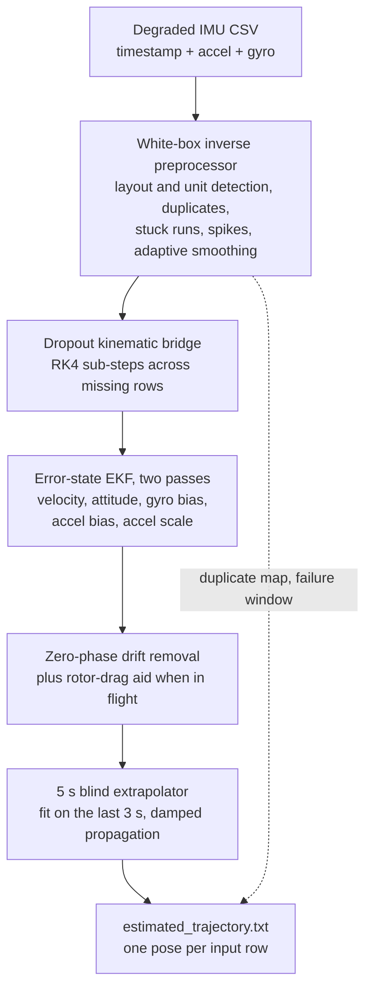
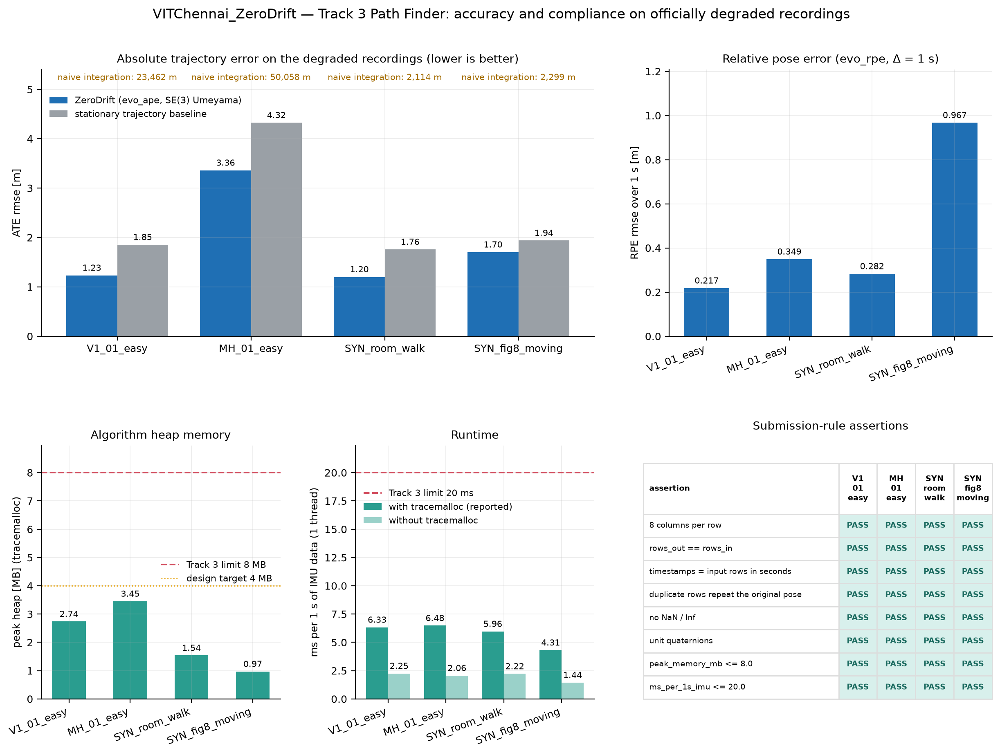
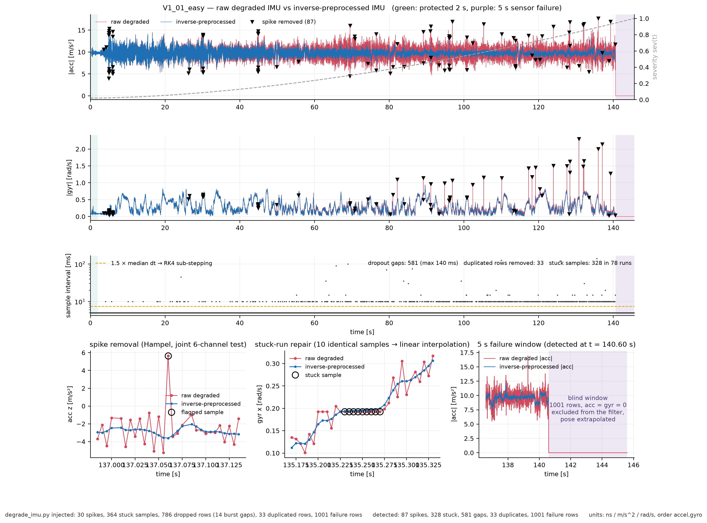
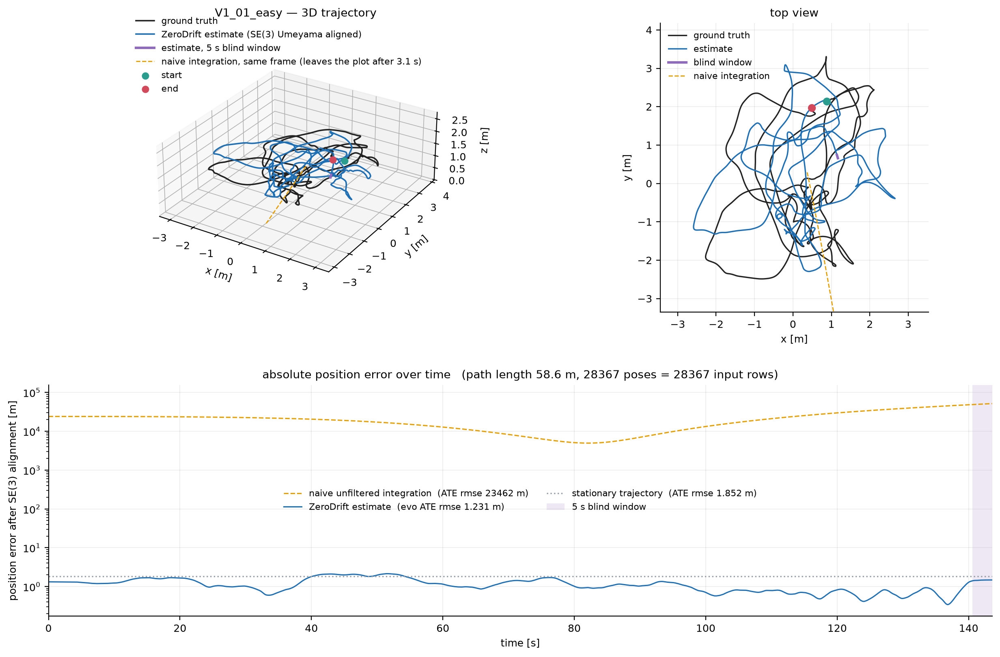

# VITChennai_ZeroDrift

**IMU-only 6-DoF trajectory estimation under severe sensor degradation**
Samsung XR Hackathon 2026 — Track 3: Path Finder

| | |
| :--- | :--- |
| **Team Name** | `VITChennai_ZeroDrift` |
| **Theme** | Track 03 - Path Finder: Trajectory Estimation Under Sensor Degradation |
| **Authors** | Gemini Sharma (`geminisharma2005@gmail.com`, GitHub: `@gem2005`)<br/>Aarav Sharma (`aaravsharma0964@gmail.com`) |
| **Email** | geminisharma2005@gmail.com, aaravsharma0964@gmail.com |
| **GitHub** | [@gem2005](https://github.com/gem2005) — [`VITChennai_ZeroDrift`](https://github.com/gem2005/VITChennai_ZeroDrift) |

`src/main.py` reads the 7-column IMU CSV produced by the organisers' `degrade_imu.py` and writes one TUM pose per input row. It uses no waypoints, images or other aiding. The runtime path imports only `numpy` and the Python standard library, runs on one thread, and is measured against the Track 3 limits (heap ≤ 8 MB, ≤ 20 ms per 1 s of IMU data).

```bash
pip install -r requirements.txt
python src/main.py --input imu0/data.csv --output estimated_trajectory.txt --meta metadata.json
```

## Architecture



| Stage | Code | What it does |
| :--- | :--- | :--- |
| White-box inverse preprocessor | `src/inverse_degrade.py` | Undoes the reversible artifacts of `degrade_imu.py` offline, before any integration |
| Dropout kinematic bridge | `preintegrate()` in `src/es_ekf.py` | Dropouts are physically missing rows. Each gap, from a single sample up to the multi-second bursts, is integrated in `round(dt / median dt)` RK4 sub-steps with interpolated rate and specific force |
| Error-state EKF | `run_filter()` in `src/es_ekf.py` | Tracks the errors of velocity, attitude, gyro bias, accelerometer bias and accelerometer scale |
| 5 s blind extrapolator | `blind_extrapolate()` in `src/es_ekf.py` | Fits terminal velocity, acceleration trend and yaw rate on the last 3 s and propagates them, damped, over the timestamps of the failure window |

Two labels differ from the usual shorthand, and the code is what counts:

- The filter carries **13 error states**, not 15: velocity (3), attitude (3), gyro bias (3), accelerometer bias (3) and accelerometer scale (1). Position is not a filter state. It is integrated from the corrected velocity and then de-drifted in a separate least-squares step.
- The blind extrapolator is a weighted least-squares fit with damped propagation. It is not an autoregressive model.

Details of each stage are in [Method](#method).

---

## Results

Measured with `scripts/benchmark_all.py`: each clean recording is degraded by the organisers' unmodified `scripts/degrade_imu.py`, estimated by `src/main.py`, and scored with `evo` after SE(3) Umeyama alignment (Windows 11, Python 3.13.6, NumPy 2.5.5, one thread).

| Sequence | Rows | ATE rmse | Stationary baseline | Naive integration | RPE rmse (1 s) | Peak heap | ms per 1 s IMU | Rules |
| :--- | ---: | ---: | ---: | ---: | ---: | ---: | ---: | :---: |
| EuRoC `V1_01_easy` | 28 367 | **1.231 m** | 1.852 m | 23 462 m | 0.217 m | 2.74 MB | 6.2 | PASS |
| EuRoC `MH_01_easy` | 35 629 | **3.359 m** | 4.323 m | 50 058 m | 0.349 m | 3.45 MB | 6.3 | PASS |
| `SYN_room_walk` | 17 500 | **1.200 m** | 1.756 m | 2 114 m | 0.282 m | 1.54 MB | 5.5 | PASS |
| `SYN_fig8_moving` | 6 852 | **1.701 m** | 1.938 m | 2 299 m | 0.967 m | 0.97 MB | 4.4 | PASS |

- **Stationary baseline** is the ATE of a trajectory that never moves; it is the score any estimator gets by outputting a constant pose. **Naive integration** is plain strapdown integration of the degraded file.
- The runtime column includes the `tracemalloc` overhead, because heap and time are measured in the same run. Without tracing it is 1.5–2.5 ms per 1 s of IMU.
- Timings vary by about ±1 ms/s between runs on the same machine.

### How to read these numbers

The estimate is 12–34 % better than a stationary trajectory and four orders of magnitude better than naive integration. It is not a centimetre-level result, and IMU-only estimation cannot be: position is the double integral of acceleration, so slow position changes are not observable without an external reference.

Running the same estimator on the **clean** recordings gives almost the same error (1.251 / 3.435 / 1.207 / 1.557 m). The injected degradation is therefore handled; what remains is the observability limit of inertial-only navigation.

| Ablation (ATE rmse, m) | V1_01_easy | MH_01_easy | SYN_room_walk | SYN_fig8_moving |
| :--- | ---: | ---: | ---: | ---: |
| Full pipeline | 1.231 | 3.360 | 1.200 | 1.701 |
| Without rotor-drag aid | 1.667 | 4.161 | 1.200 | 1.701 |
| Without adaptive smoother | 1.230 | 3.392 | 1.199 | 1.700 |
| Clean (undegraded) input | 1.251 | 3.435 | 1.207 | 1.557 |



---

## Quick start

```bash
git clone https://github.com/gem2005/VITChennai_ZeroDrift.git
cd VITChennai_ZeroDrift
```

### 1. Standard Python 3.11

```bash
pip install -r requirements.txt
python src/main.py --input <path/to/imu0/data.csv> --output estimated_trajectory.txt
```

`requirements.txt` holds the single runtime dependency, `numpy>=1.24.0`. Tested on Python 3.11.9 with NumPy 1.24.0 and 2.4.6, and on Python 3.13.6 with NumPy 2.5.5; all three reproduce the committed `estimated_trajectory.txt` to within 1 µm.

### 2. uv

Requires [uv](https://docs.astral.sh/uv/). `pyproject.toml` and `uv.lock` pin the full environment, including the verification tools.

```bash
uv sync                                   # creates .venv from uv.lock
uv run python src/main.py --input <path/to/imu0/data.csv> --output estimated_trajectory.txt --meta metadata.json

# full verification suite (degrade -> estimate -> assert -> evo -> plots)
bash scripts/evaluate.sh                                             # Linux / macOS / Git Bash
powershell -ExecutionPolicy Bypass -File scripts/evaluate.ps1        # Windows
```

### 3. Docker

```bash
docker build -t vitchennai_zerodrift .
docker run --rm -v "$PWD:/io" vitchennai_zerodrift \
    --input /io/imu0/data.csv --output /io/estimated_trajectory.txt --meta /io/metadata.json
```

The image is `python:3.11-slim` with `numpy`, `src/` and `README.md`. Its entry point is `python3 src/main.py`, so everything after the image name is an argument of the estimator. In PowerShell write the mount as `-v "${PWD}:/io"`.

### Command line

All of these are accepted, from the repository root or from inside `src/`:

```bash
python src/main.py --input imu0/data.csv --output estimated_trajectory.txt --meta metadata.json
python src/main.py -i imu0/data.csv -o estimated_trajectory.txt -m metadata.json
python src/main.py imu0/data.csv estimated_trajectory.txt        # positional
python src/main.py                                               # no arguments
cd src && python main.py --input ../imu0/data.csv --output ../estimated_trajectory.txt
```

- Without `--meta`, the statistics are written as `metadata.json` next to the trajectory.
- Without any argument, the input is `imu0/data.csv` (working directory, then repository root), otherwise the degraded test file `data/imu0/data.csv`, and both outputs are written to the repository root. `data/imu0/data.csv` is `V1_01_easy` degraded by the official script; running `python src/main.py` in a fresh clone regenerates the committed `estimated_trajectory.txt`.

### Dependencies

`requirements.txt` is the runtime set (`numpy`). `requirements-dev.txt` is the full environment exported from `pyproject.toml` with `uv pip compile pyproject.toml -o requirements-dev.txt`: `scipy` and `pandas` are needed by `degrade_imu.py`, and `evo` and `matplotlib` by the verification suite.

### Input

A CSV with a timestamp and six sensor columns, with or without a header row. The layout is detected automatically:

| Property | Detection |
| :--- | :--- |
| Column order | Header names (`a_RS`/`acc` vs `w_RS`/`gyr`); without a usable header, the block whose median norm over the first 2 s lies in 0.5–2 g or 5–15 m/s² is the accelerometer |
| Timestamp unit | s, ms, µs or ns from the median sample period |
| Accelerometer unit | g or m/s² from the gravity norm |
| Gyroscope unit | deg/s or rad/s from the rate magnitude and the gyro-to-accel noise ratio |

### Output

`estimated_trajectory.txt` holds `timestamp tx ty tz qx qy qz qw`, timestamps in seconds, **exactly one pose per input row in input order**. Rows are never added or removed: duplicated rows receive the pose of the row they repeat, and the rows of the failure window receive extrapolated poses.

`metadata.json` reports `rows_in`, `rows_out`, `peak_memory_mb`, `ms_per_1s_imu`, `compliant`, what the preprocessor detected, and estimator diagnostics. The exit status is 0 whenever a trajectory was written.

---

## Method

The FAQ allows offline, non-causal batch processing, so the whole recording is processed at once.

### 1. White-box inverse preprocessor — `src/inverse_degrade.py`

`degrade_imu.py` is public, so each artifact it injects has a known signature.

| Injected artifact | Signature | Remedy |
| :--- | :--- | :--- |
| Duplicated rows | `dt == 0` | Removed before estimation; the original's pose is copied back at output |
| Failure window (last 5 s zeroed) | Trailing block with ‖acc‖ < 1e-4 and ‖gyr‖ < 1e-5 | Excluded from filtering; poses are extrapolated |
| Stuck runs (2–10 samples) | Consecutive samples identical within 1e-7 with `dt > 0` | Linear interpolation in time |
| Spikes | 5-point median + MAD (Hampel) test at 3·MAD, or a jump above 2.5 m/s² / 0.4 rad/s that returns immediately | Median of the neighbours |
| White noise growing with severity | High-frequency energy | Zero-phase smoother whose bandwidth follows `(t/T)^1.7` |
| Dropped rows (single and bursts) | `dt > 1.5 × median dt` | Sub-stepped by the estimator |

On the four benchmark files, duplicated rows (33 / 49 / 22 / 11) and failure rows (1001 / 1001 / 1001 / 501) are found exactly. Spikes removed versus injected are 87/30, 35/38, 13/13 and 6/6; injected counts include samples that `degrade_imu.py` later drops, so they need not match exactly. The surplus on `V1_01_easy` is genuine single-sample vibration impulses of the vehicle, and replacing them changes the ATE by less than 1 cm.



### 2. Estimator — `src/es_ekf.py`

1. **Protected initialisation.** Gravity magnitude, roll/pitch and initial gyro bias come from the first 2 s, which `degrade_imu.py` leaves clean.
2. **Preintegration with dropout sub-stepping.** RK4 quaternion, velocity and position kinematics. An interval with `dt > 1.5 × median dt` is split into `round(dt / median dt)` sub-steps with linearly interpolated rate and specific force.
3. **13-state error-state Kalman filter** at 10 Hz over velocity, attitude, gyro bias, accelerometer bias and accelerometer scale. Process noise follows the severity ramp of `degrade_imu.py`. Measurements are a pseudo-drag velocity regulariser, zero-velocity and gyro-bias updates at detected standstill, and gravity-norm consistency in low-dynamics intervals. It runs twice; the second pass is re-linearised around the biases learned by the first.
4. **Zero-phase drift removal.** The dead-reckoned position is separated into slow drift and motion by a penalised least-squares problem solved with a banded solver. The cut-off period shortens as severity grows.
5. **Rotor-drag velocity aid** (see below).
6. **Blind extrapolation.** A weighted least-squares fit over the last 3 s before the failure gives terminal velocity, acceleration trend and yaw rate. These are propagated with exponential damping over the exact timestamps of the failure window.



### Rotor-drag velocity aid — an explicit platform assumption

On a multirotor in flight, the specific force perpendicular to the thrust axis is rotor drag, which is proportional to body velocity. On both EuRoC sequences this signal correlates at −0.90 to −0.95 with the true body velocity in the 6–80 s band, which is exactly the band where inertial integration fails. The estimator uses it as displacement information in the drift-removal step.

- It is active only where a detector, working from the estimated attitude alone, finds the platform thrust-borne for at least 20 s. `MH_01_easy` is hand-carried and then parked for its first 40 s; that phase is correctly excluded. Both synthetic sequences are correctly classified as not thrust-borne, and the aid stays off.
- The drag coefficient is a fixed prior, μ = 0.25 s⁻¹. Values from 0.2 to 0.3 perform similarly on both EuRoC sequences. Estimating μ from the data was tried and does not work.
- The coefficient and the cut-off periods were tuned on the same two EuRoC sequences that are reported above, so those two results are in-sample. On a different airframe the gain may be smaller.
- It is disabled with `"drag_aid": False` in `PARAMS` (`src/es_ekf.py`); the "without rotor-drag aid" row above shows the result.

---

## Verification suite

`scripts/benchmark_all.py` (wrapped by `scripts/evaluate.sh` and `scripts/evaluate.ps1`) does the following for `V1_01_easy`, `MH_01_easy` and two synthetic recordings:

1. Writes the clean recording as a 7-column CSV and a TUM ground-truth file.
2. Degrades it with `scripts/degrade_imu.py <clean.csv> <degraded.csv> --meta stats.json`.
3. Runs `uv run python src/main.py --input degraded.csv --output estimated_trajectory.txt --meta metadata.json`.
4. Asserts: `rows_out == rows_in`, 8 columns, timestamps equal to the input rows in seconds, duplicated rows repeat the original pose, no NaN/Inf, unit quaternions, `peak_memory_mb <= 8.0`, `ms_per_1s_imu <= 20.0`.
5. Scores with `evo_ape tum gt.tum estimated_trajectory.txt -va --align` and `evo_rpe tum gt.tum estimated_trajectory.txt -va --align --delta <frames in 1 s> --delta_unit f`.
6. Scores the naive-integration and stationary baselines with the same alignment.
7. Renders the plots into `plots/` and writes `results/summary.json`.

`evo_rpe` has no seconds unit for `--delta` (it accepts `f`, `d`, `r`, `m`), so the 1 s interval is passed as the number of frames spanning one second.

The EuRoC IMU and ground-truth CSVs (a few MB) are downloaded by `scripts/fetch_euroc.py` on first use. If they cannot be fetched, the EuRoC sequences are skipped and the synthetic ones still run.

`scripts/test_input_formats.py` rewrites a degraded file in 22 layouts (column orders, units, timestamp units, CRLF, NaN cells, 1-row to 2000-row files, all-zero and constant sensors, empty file) and checks that each is detected and handled.

### Submission contract and bundle

```bash
uv run python scripts/verify_submission_contract.py     # Slide 16 / FAQ checks on the root files
uv run python scripts/package_submission.py             # dist/VITChennai_ZeroDrift.zip + smoke test
```

`scripts/verify_submission_contract.py` checks `estimated_trajectory.txt` and `metadata.json` against the input CSV: space-separated with `#` comments only, exactly 8 floats per row, timestamps equal to the input timestamps in seconds, one pose per IMU row including the blind window and the duplicated timestamps, no NaN/Inf, quaternion norms within 1e-4 of 1, `peak_memory_mb <= 8.0` and `ms_per_1s_imu <= 20.0`.

`scripts/package_submission.py` writes `dist/VITChennai_ZeroDrift.zip` with `estimated_trajectory.txt`, `metadata.json`, `README.md`, `requirements.txt`, `Dockerfile` and `src/` (no byte-code). It changes nothing else in the repository. It then extracts the archive into a temporary `test_eval` directory and runs `src/main.py` there in every invocation style, and checks that the run imports nothing beyond `numpy` and the standard library.

---

## Limits

- **Recording length.** Heap grows by roughly 0.1 MB per 1000 rows. Measured: 3.45 MB at 184 s, 6.90 MB at 368 s, 10.32 MB at 552 s (all 200 Hz). The 8 MB limit is reached at about 7 minutes of 200 Hz data; the 4 MB design target holds up to about 3.5 minutes.
- **Sustained turning without a standstill.** On `SYN_fig8_moving` the platform circles continuously and never stops. The zero-velocity prior then reads part of the centripetal acceleration as tilt and gyro bias, and the gain over the stationary baseline is small (12 %).
- **Slow motion is weakly observable** without the drag aid: on non-multirotor data the estimate keeps the shape of fast motion but not slow excursions.
- **Docker.** The submission `Dockerfile` was built and run (Python 3.11.18, NumPy 2.4.6, Linux container): 6.4 ms per 1 s of IMU, 2.72 MB peak heap, and a trajectory identical to the committed one. `Dockerfile.dev` has not been built or run.

---

## Repository structure

```
VITChennai_ZeroDrift/
├── main.py                        # forwards to src/main.py
├── src/
│   ├── main.py                    # CLI entry point, TUM writer, heap/time measurement
│   ├── inverse_degrade.py         # layout auto-detection + white-box inverse preprocessor
│   └── es_ekf.py                  # preintegration, error-state KF, drift removal, drag aid, blind extrapolation
├── scripts/
│   ├── degrade_imu.py             # official organiser script (unmodified)
│   ├── benchmark_all.py           # verification suite
│   ├── make_plots.py              # figures for the suite
│   ├── synthetic_sequences.py     # two synthetic recordings with exact ground truth
│   ├── fetch_euroc.py             # downloads EuRoC IMU + ground-truth CSVs only
│   ├── test_input_formats.py      # layout / unit / degenerate-input checks
│   ├── verify_submission_contract.py  # Slide 16 / FAQ checks on the root output files
│   ├── package_submission.py      # builds and smoke-tests dist/VITChennai_ZeroDrift.zip
│   ├── evaluate.sh                # wrapper (bash)
│   └── evaluate.ps1               # wrapper (PowerShell)
├── data/imu0/data.csv             # default test input: V1_01_easy degraded by the official script
├── docs/Track3_FAQ_Responses.txt  # official FAQ
├── plots/                         # generated figures
├── results/summary.json           # generated benchmark table
├── estimated_trajectory.txt       # output for data/imu0/data.csv
├── ground_truth_trajectory.txt    # matching ground truth (TUM)
├── metadata.json                  # runtime / heap / diagnostics of that run
├── pyproject.toml, uv.lock        # uv project (full environment)
├── requirements.txt               # runtime dependency: numpy>=1.24.0
├── requirements-dev.txt           # full environment, exported with uv pip compile
├── Dockerfile                     # submission image: python:3.11-slim, ENTRYPOINT src/main.py
├── Dockerfile.dev                 # development image with the verification suite (uv)
└── dist/VITChennai_ZeroDrift.zip  # submission bundle (generated, not committed)
```

## Docker

The submission image contains only the estimator:

```bash
docker build -t vitchennai_zerodrift .
docker run --rm -v "$PWD:/io" vitchennai_zerodrift \
    --input /io/imu0/data.csv --output /io/estimated_trajectory.txt --meta /io/metadata.json
```

`Dockerfile.dev` is the earlier development image. It installs the full environment with uv and runs the verification suite:

```bash
docker build -f Dockerfile.dev -t vitchennai_zerodrift_dev .
docker run --rm vitchennai_zerodrift_dev             # runs scripts/evaluate.sh
```
